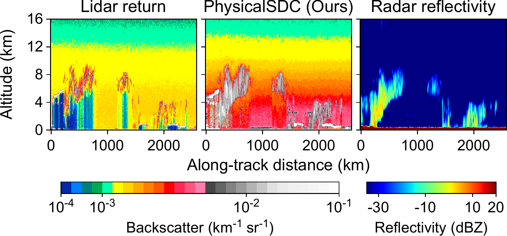
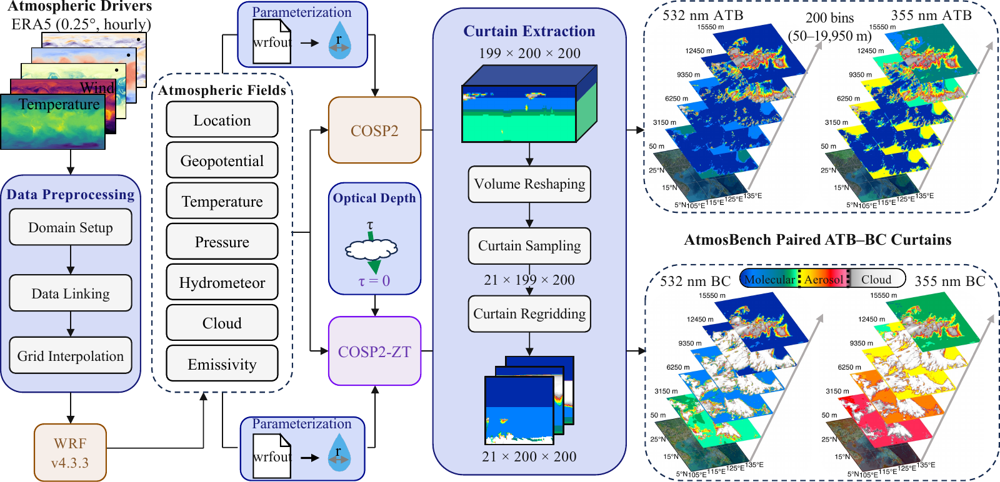
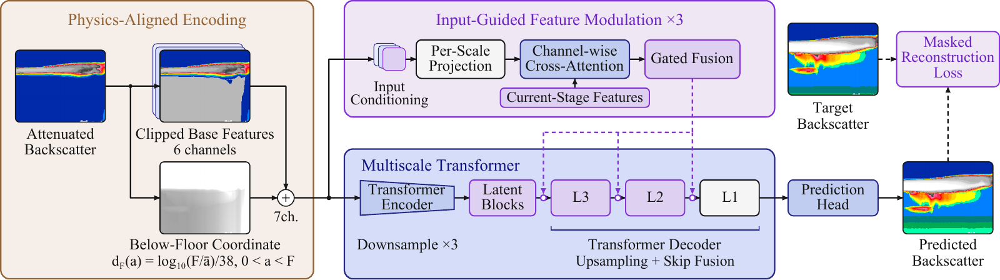

# The Floor Is Not the Limit: Representing Physics-Aligned Weak LiDAR Returns

Strong attenuation weakens spaceborne lidar returns beneath clouds, making the underlying atmospheric structure difficult to retrieve. We introduce **Physical Subfloor Deficit Coordinate (PhysicalSDC)**, a single-wavelength backscatter retrieval method centered on **Physics-Aligned Encoding**. The parameter-free input module uses the logarithmic attenuation relation in the lidar equation to preserve differences between finite positive returns below the nominal signal floor. It feeds an AdaIR-derived retrieval backbone and can be paired with other backbones.

We construct **AtmosBench** with 36,288 paired attenuated total backscatter (ATB) and backscatter coefficient (BC) curtains at 355 and 532 nm from 48 ERA5-driven WRF–COSP events. The paired renderings share the same atmospheric state. On held-out events, PhysicalSDC reduces log MAE by 12.45% relative to RawLog. Applied without fine-tuning, it improves agreement with operational CALIPSO cloud profiles and reduces layer-base error by 27.29% relative to RawLog on PACE-PAX airborne lidar. Retained weak returns can thus help retrieve vertical structure and trace atmospheric layers under attenuation.

Tianchi Xu, Yuanpeng He, Jintao Xu, Kang He, Linyu Li, Huanyao Zhang, Dongming Jin, Bohan Zhou, Wenpin Jiao, and Zhi Jin. KDD 2027, AI for Sciences.

[OpenReview record](https://openreview.net/forum?id=5b9wzLyUdE) · [Dataset card](atmosbench/README.md) · [Download data and weights](ASSETS.md) · [Paper results](results/README.md) · [Citation](CITATION.cff)

## CPU quickstart

From the repository root, use Python 3.10 or 3.11. On Linux, use the PyTorch CPU index for the first command by appending `--index-url https://download.pytorch.org/whl/cpu`. The standard wheel works on macOS.

```bash
python -m pip install torch==2.5.1
python -m pip install -r code/requirements.txt
python examples/quickstart.py
```

The quickstart evaluates `adair_physicalsdc_run1`, one of the three released AdaIR PhysicalSDC checkpoints, on eight canonical AtmosBench pairs (one per test event and wavelength). The ~2 MB sample is included, and the script downloads and verifies the ~116 MB checkpoint. Run with `--checkpoint /path/to/adair_physicalsdc_run1.pt` to reuse a verified local copy. Expect `8 pairs, log-MAE 0.01836 dex` and a score report in `outputs/quickstart.json`. The full test split contains 3,024 pairs.

## Evaluate or train

| Task | Guide |
| --- | --- |
| Run PhysicalSDC on a curtain or all 3,024 test pairs | [Retrieval and evaluation](code/README.md#run-inference) |
| Score predictions from your own model | [Prediction format and scoring](code/PREDICTIONS.md) |
| Train PhysicalSDC or a matched baseline | [Training guide](code/README.md#train-physicalsdc) |
| Recompute supported paper tables from reported scores | [Paper results](results/README.md) |
| Prepare WRF–COSP inputs or render paired curtains | [Dataset generation](code/generation/README.md) |
| Trace a paper result to its data and configuration | [Reproducibility](code/REPRODUCIBILITY.md) |

The fixed event split contains 40 training, four validation and four reserved test events. Download the [latest camera-ready source](https://github.com/TianchiXu1/AtmosBench/releases/latest), [AtmosBench data (v1.0.0)](https://github.com/TianchiXu1/AtmosBench/releases/tag/v1.0.0), and [three PhysicalSDC checkpoints (v1.1.0)](https://github.com/TianchiXu1/AtmosBench/releases/tag/v1.1.0). The [reproducibility guide](code/REPRODUCIBILITY.md) specifies the settings and inputs for each comparison.

To reproduce supported numerical aggregates from the distributed result records, run from the repository root:

```bash
python code/scripts/reproduce_tables.py --output reproduced_results
```

See [Paper results](results/README.md) for the underlying records and the scope of this calculation. Share questions or report issues through [GitHub Issues](https://github.com/TianchiXu1/AtmosBench/issues).

## Figures from the paper



**Figure 1. Retrieval beneath cloud.** On EarthCARE orbit 02963C, co-orbiting radar provides a structural reference for the lidar-based estimate. The estimate shows structure beneath the cloud deck where the measured lidar return weakens. The radar panel uses a linear reflectivity scale, and Appendix A.1 gives the discrete lidar backscatter intervals. [PDF](figures/figure1_earthcare.pdf)



**Figure 2. AtmosBench data generation.** Two renderings of the same atmosphere produce pixel-aligned attenuated returns and unattenuated backscatter at 355 and 532 nm. The layered views illustrate the two renderings. The square thumbnails show representative 532 nm backscatter curtains. [PDF](figures/figure2_atmosbench.pdf)



**Figure 3. PhysicalSDC retrieval pipeline.** Our parameter-free Physics-Aligned Encoding augments the input to an AdaIR-derived backbone. The paired backscatter target supervises the prediction through the masked reconstruction loss. [PDF](figures/figure3_physicalsdc.pdf)

## Licenses

Original software uses the [MIT license](LICENSE). The authors' benchmark arrays and trained weights use [CC BY 4.0](atmosbench/LICENSE-DATA.md). [Upstream software](code/THIRD_PARTY.md) and [provider products](atmosbench/SOURCES.md) retain their source terms.
